# TP 5-2 : Service de banque avec RMI et JNDI

**Étudiante :** Hana Ben Hmad - LSI3

**Matière :** Développement d'applications réparties

**Enseignante des TPs :** Zeineb DAOUD

## Objectif

Développer une application répartie de gestion de comptes bancaires avec Java RMI, puis remplacer l'accès direct au registre RMI par JNDI.

Un compte est défini par un code (int), un solde (double) et une date de création (Date).

Le serveur offre deux services distants : créer un compte (si le code n'existe pas déjà) et consulter un compte à partir de son code.

## Étape 1 : Préparation de l'espace de travail

Dossier de travail `hanabenhmad_LSI3_Banque` avec un sous-dossier `captures`.

## Étape 2 : Développement du serveur (RMIBanque_Server)

### Arborescence du projet

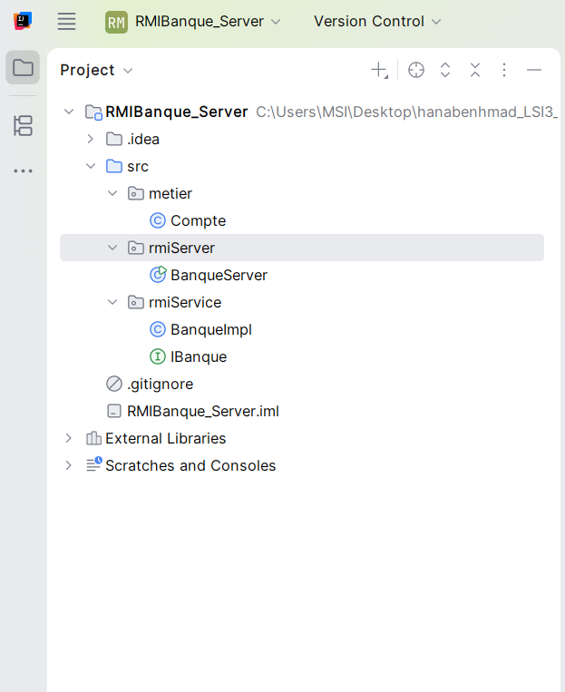

### Classe Compte (package metier)

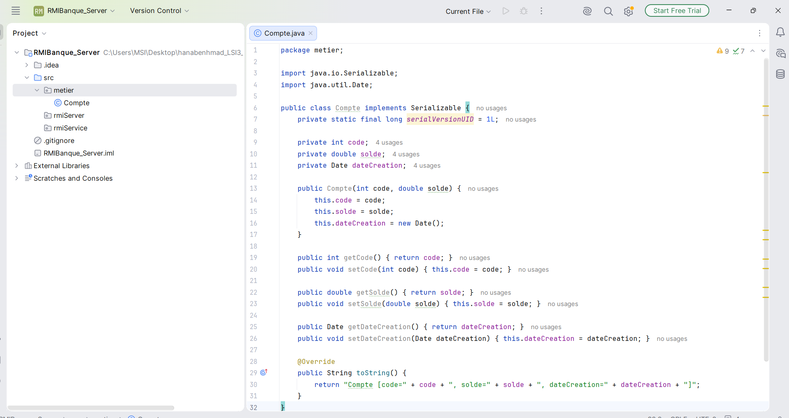

### Interface IBanque (package rmiService)

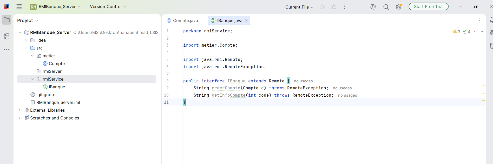

### Classe BanqueImpl (package rmiService)

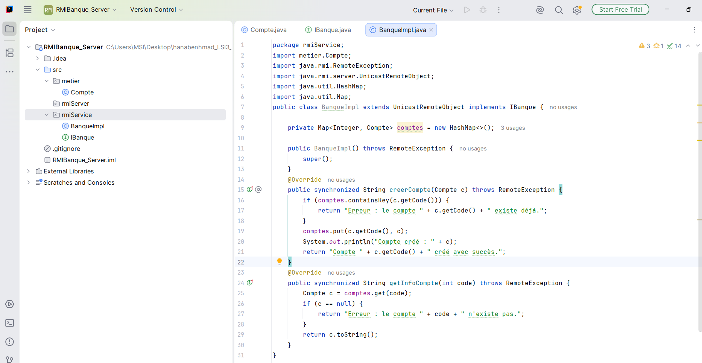

### Classe BanqueServer, version 1 (package rmiServer)

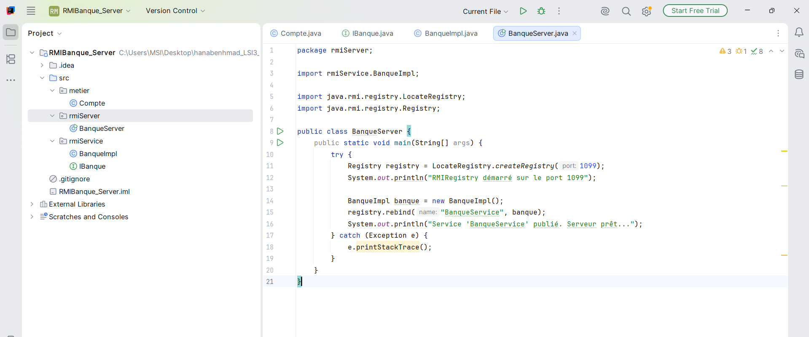

## Étape 3 : Développement du client (RMIBanque_Client)

### Génération du fichier banqueClient.jar

Le jar contient uniquement IBanque et Compte, sans BanqueImpl.

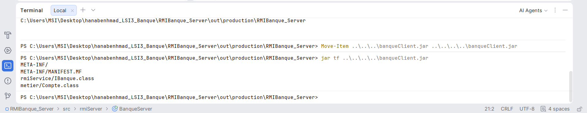

### Ajout du jar au classpath du client

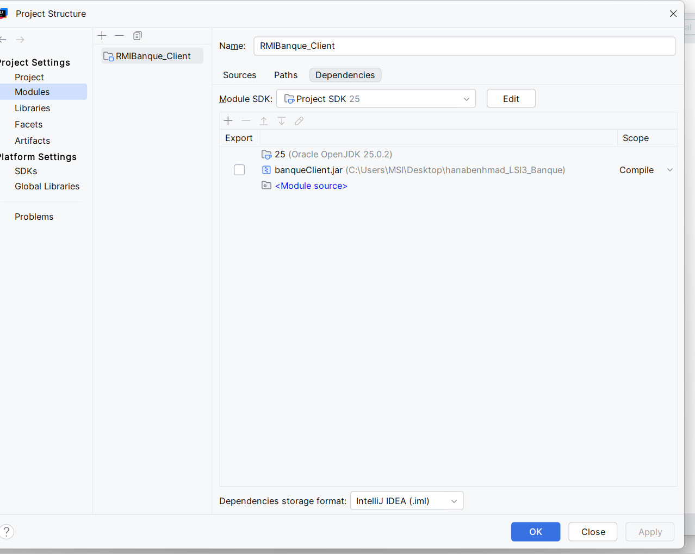

### Classe BanqueClient, version 1 (package rmiClient)

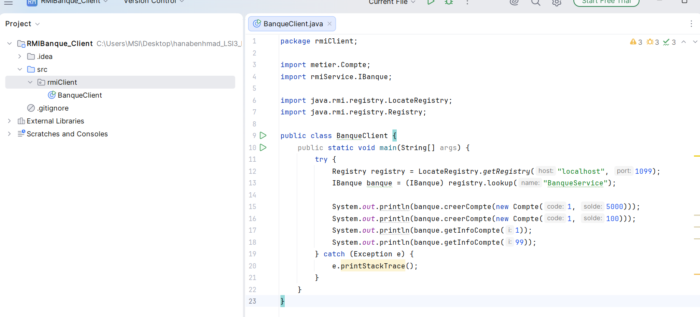

## Étape 4 : Exécution (version 1, sans JNDI)

### Démarrage du serveur

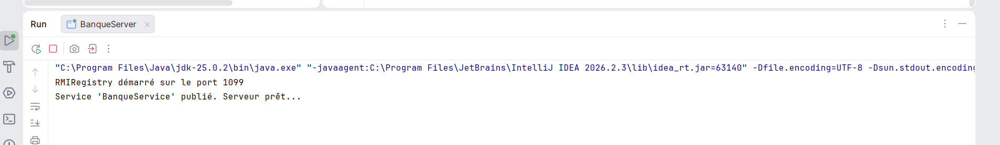

### Résultat du client

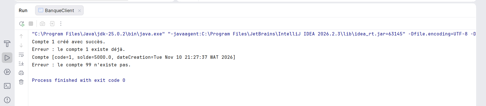

### Console du serveur après la requête

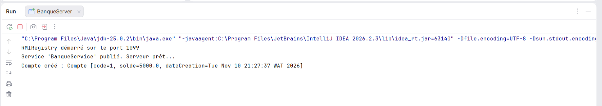

## Étape 5 : Utilisation de JNDI

### Fichier jndi.properties du serveur

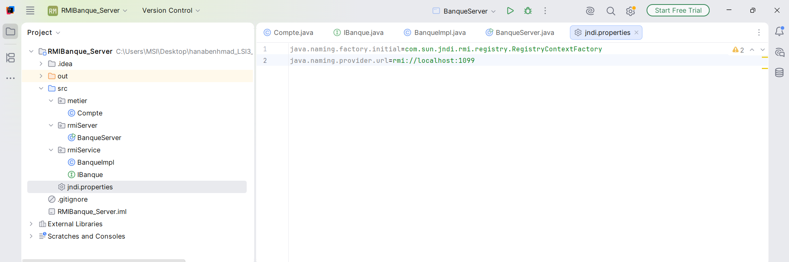

### Fichier jndi.properties du client

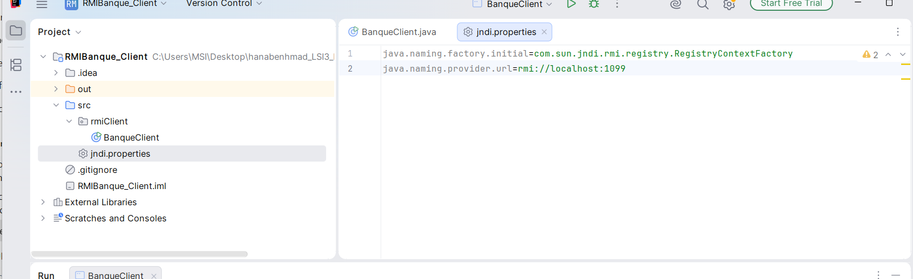

### BanqueServer, version JNDI

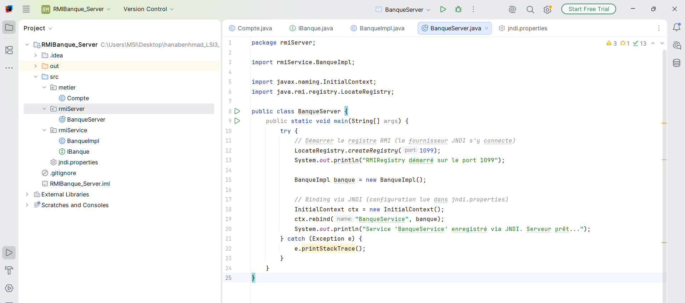

### BanqueClient, version JNDI

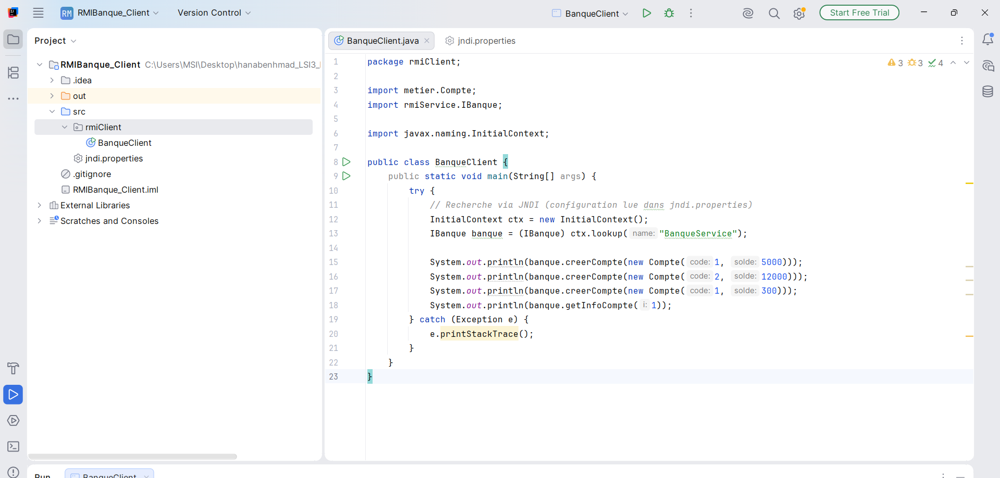

### Exécution du serveur JNDI

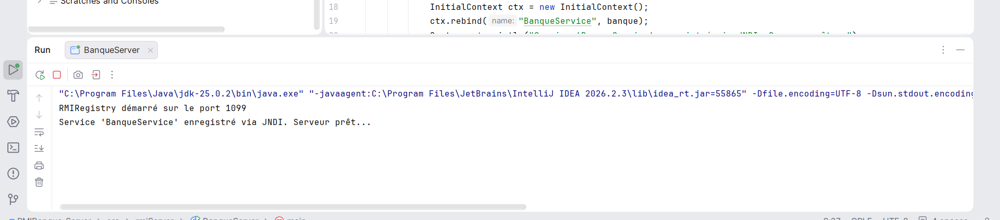

### Exécution du client JNDI

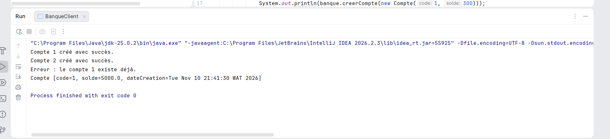

## Étape 6 : Dépôt sur GitHub

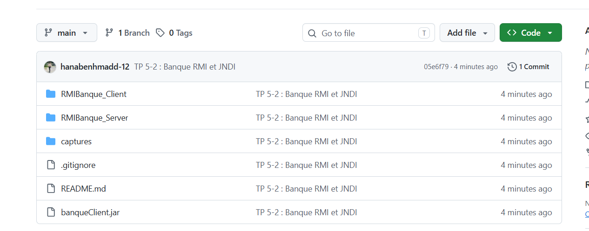

## Synthèse

Ce TP m'a permis de mettre en œuvre une application répartie de gestion de comptes bancaires avec Java RMI, puis d'intégrer JNDI.

**Architecture.** Le serveur (RMIBanque_Server) contient la classe sérialisable `Compte`, l'interface distante `IBanque`, son implémentation `BanqueImpl` et la classe `BanqueServer`. Le client (RMIBanque_Client) ne reçoit que `IBanque` et `Compte`, via le fichier `banqueClient.jar`. `BanqueImpl` reste côté serveur : le client n'a besoin que du contrat, pas de l'implémentation.

**Version 1 (RMI seul).** Le serveur crée le registre RMI sur le port 1099 et enregistre le service avec `Naming`. Le client le retrouve avec `Naming.lookup()` puis appelle `creerCompte` et `getInfoCompte` comme sur un objet local. Le test a montré la création des comptes et le refus d'un code déjà existant.

**Version 2 (RMI avec JNDI).** Le fichier `jndi.properties` placé dans `src` (côté serveur et côté client) indique la fabrique `RegistryContextFactory` et l'URL `rmi://localhost:1099`. Le serveur utilise `InitialContext.rebind()` et le client `InitialContext.lookup()`. Le code ne dépend plus directement de `Naming` : le fournisseur d'annuaire se change dans la configuration, sans modifier le code.

**Résultat.** Les résultats de la version JNDI sont identiques à ceux de la version 1, ce qui confirme que la communication RMI fonctionne toujours.

**Difficultés et points retenus.** Il faut démarrer le serveur avant le client, l'arrêter avant de le relancer (port 1099 occupé), et ne mettre que `IBanque` et `Compte` dans le jar. Le même `Compte` doit exister des deux côtés, car l'objet est sérialisé entre le client et le serveur.
